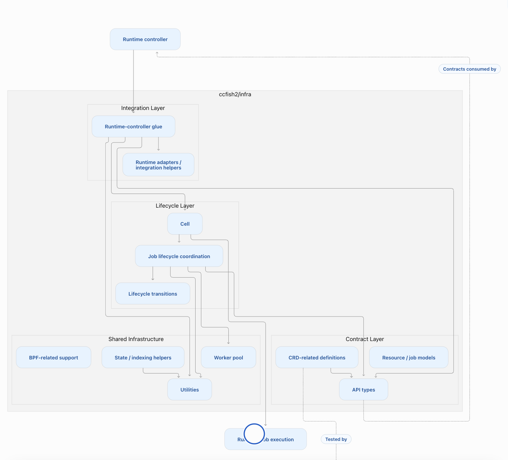

# infra
This repo includes infra that supports controller, reconciling custom resources

  

# CRD Tests
assets=$(go run sigs.k8s.io/controller-runtime/tools/setup-envtest@latest use 1.32.x -p path) && KUBEBUILDER_ASSETS="$assets" go test ./tests/crd/...